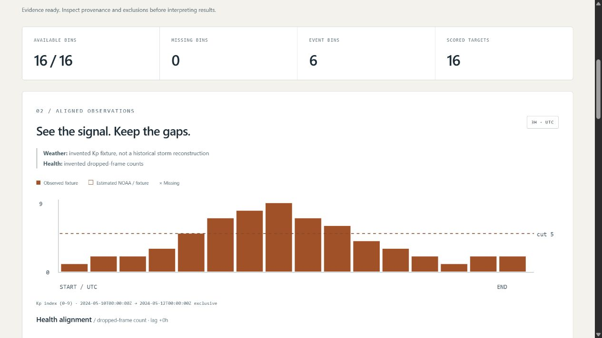

# Space Weather Impact Observatory

**Signals. Evidence. Context.** An offline analysis application designed and engineered by [Jason Stys](https://github.com/JasonStys).

[](https://github.com/JasonStys/space-weather-impact-observatory/actions/workflows/validate.yml)
[](https://github.com/JasonStys/space-weather-impact-observatory/actions/workflows/codeql.yml)



Inspect estimated planetary Kp, preserve missing observations, verify forecast eligibility, and explore **descriptive—not causal—associations** with supplied mission-health records. The app runs in your browser from source or an extracted portable download. Python handles data validation/statistics, TypeScript handles interaction/SVG, and SQL provides opt-in immutable local history.

## What makes the evidence trustworthy

- A frozen, checksum-verified **NOAA SWPC** response with 56 estimated three-hour Kp bins; the separate forecast response preserves 17 predicted records with **unknown issuance**. They cannot be used for historical skill claims.
- Five additional **invented** cases: storm-shaped signal/health, missing bins, forecast revisions/leakage, constant signals and an empty observation window. No real mission-health data is bundled, and the synthetic May dates do not reconstruct a historical storm.
- Exact UTC three-hour alignment. A positive health lag pairs weather at `t` with health at `t + lag`; omitted/null values stay missing. No interpolation or missing-as-zero behavior.
- Forecast issue time must precede the target by at least the chosen lead. Only the **latest eligible revision per target**, selected without looking at its error, contributes to MAE/RMSE/bias and the threshold confusion table in JSON.
- Descriptive Pearson correlation with explicit insufficient/constant-series outcomes, separate-unit weather/health plots, exact bin inspector and filterable ledger. No p-values, confidence intervals, automatic lag optimization or causal inference.
- Full-context JSON, aligned-bin CSV, inert HTML and portable input JSON. Content SHA-256 and opt-in local SQLite history preserve reproducibility, not authenticated authorship.
- Read-only loopback service, finite browser controls, bounded CLI imports, strict dependencies, cross-platform/browser CI and exact-line documentation checks.

This is **educational research software**, not current conditions, an authoritative forecast, a spacecraft damage model, flight-qualified software or mission guidance. Kp is a quasi-logarithmic planetary index, not local radiation/dose. Association cannot establish that space weather caused a health event. [Scientific limitations](docs/MODEL.md), [data provenance](docs/DATA.md).

## Launch a download

Get your OS ZIP and `.sha256` from [Releases](https://github.com/JasonStys/space-weather-impact-observatory/releases). Verify the ZIP hash, extract the **entire** directory and launch `SpaceWeatherObservatory` (`.exe` on Windows). It opens a loopback website in your default browser. Stop the console with Ctrl-C. No global Python/Node installation, account, cloud API or administrator rights are needed for the portable app.

Bundles are **unsigned/not notarized**, targeting Windows x64, Linux x86_64 and macOS ARM64 CI environments—not all devices/distributions or mobile operating systems. Never bypass OS warnings, remove quarantine, disable security or run elevated. Use reviewed source if policy blocks unsigned apps. This is a local browser application, not public hosting or a multi-user authenticated service.

## Run from source

Requirements: CPython 3.12–3.14 and Node 24. No third-party Python runtime dependencies.

```text
python -m venv .venv
# Windows: .venv\Scripts\activate
# Linux/macOS: source .venv/bin/activate
python -m pip install --require-hashes -r requirements-dev.lock
npm ci
npm run build
python -m weatherlab serve
```

The printed URL is `http://127.0.0.1:<ephemeral-port>/`. `serve --no-browser --port 8846` opts into a fixed local port. No network fetch is performed by the running app.

Start with **NOAA frozen snapshot**. Observe that health and scores are unavailable rather than invented. Choose **Forecast revisions and leakage**, expand the forecast ledger, then compare minimum lead 3 vs 12 vs 24 hours. Try **Missing and estimated bins**, a positive health lag, the missing filter and individual bin inspection. Help and provenance are available in the interface.

## CLI and local input

```text
python -m weatherlab export --scenario synthetic-storm --output evidence.json
python -m weatherlab export --scenario synthetic-storm --format input --output case.json
python -m weatherlab export --input examples/synthetic-storm.json --lag_hours 3 --lead_hours 12 --threshold 5 --output local-evidence.json --history local.sqlite3
```

Imports are strict UTF-8 JSON, at most 512 KiB, 256 grid bins and 2048 forecast revisions. Exact keys, finite ranges, UTC/grid alignment and uniqueness are validated. Imported provenance is **unverified local input**, even if its name imitates NOAA. File import and history are CLI-only, not browser upload endpoints. History is unencrypted local data; exports never overwrite, history is capped at 100 distinct reports and never pruned automatically. Use synthetic/non-sensitive records. See [input/API contract](docs/API.md).

## Test and verify

```text
python -m ruff check weatherlab tests tools launcher.py
python -m ruff format --check weatherlab tests tools launcher.py
python -m mypy weatherlab
python -m pytest --cov=weatherlab --cov-report=term-missing
python -m tools.benchmark
python tools/verify_repo.py
npm run format:check
npm test
npm run build
npx playwright install chromium firefox webkit
npm run test:e2e
```

Linux browser setup may need `--with-deps`. Raw NOAA snapshots are excluded from formatting and text conversion to preserve original bytes. CI exercises four OS/Python configurations, three browser engines, three actual frozen-app builds/smokes and Python/TypeScript CodeQL. No Actions artifacts/caches are uploaded. [Observed results and gaps](docs/VALIDATION.md).

## File and feature map

| Area                                                 | Responsibility                                                                                                         |
| ---------------------------------------------------- | ---------------------------------------------------------------------------------------------------------------------- |
| `weatherlab/model.py`                                | Typed immutable input, exact UTC, finite values, unique records, bounded duplicate-key-safe JSON                       |
| `weatherlab/engine.py`                               | Verified NOAA adapter, invented cases, exact joins, descriptive statistics, issue/revision gates and evidence identity |
| `weatherlab/reports.py`, `resources/history.sql`     | JSON/CSV/HTML/input rendering, verified parameterized history with immutable triggers                                  |
| `weatherlab/server.py`, `__main__.py`, `launcher.py` | Protected read-only loopback API, no-overwrite CLI and portable entry point                                            |
| `weatherlab/resources/`                              | Original public responses, checksums/date/URLs and SQL schema—not credentials or personal history                      |
| `web/`                                               | Semantic controls, independently scaled SVG plots, ledgers/inspector, safe rendering and unit contracts                |
| `tests/`                                             | Finite grid, independent arithmetic/property, import/CLI/SQL/HTTP and actual browser acceptance                        |
| `tools/`                                             | Deterministic contracts/profiling, source inventories, frozen-app packaging/smoke and draft releases                   |
| `.github/workflows/`                                 | Validation, CodeQL and manually gated three-platform release                                                           |
| `docs/`, `examples/`, `licenses/`                    | Design/usage/model/data/security/evidence, editable synthetic input and runtime notices                                |

Every file is summarized in [FILE_CATALOG](docs/FILE_CATALOG.md). Source headers and definition contracts describe responsibilities and variables; [CODE_INDEX](docs/CODE_INDEX.md) gives generated exact definition/argument/variable locations instead of fragile duplicate line numbers in comments. CI rejects missing Python contracts/creator headers or stale indexes.

## Author and sources

By [Jason Stys](https://github.com/JasonStys). [Portfolio](https://jasonstys.github.io/portfolio-case-study-site/) · [Help/contact/issues](https://github.com/JasonStys/space-weather-impact-observatory/issues).

Original code is MIT. NOAA/NWS material remains attributed public-domain government information, not the author's copyrighted data. See [third-party notices](docs/THIRD_PARTY.md). No NOAA, NASA, government, military or contractor endorsement/affiliation is implied. Primary references: [NOAA Kp product](https://www.swpc.noaa.gov/products/planetary-k-index), [NOAA scales](https://www.swpc.noaa.gov/noaa-scales-explanation) and [NWS reuse notice](https://www.weather.gov/disclaimer/).
